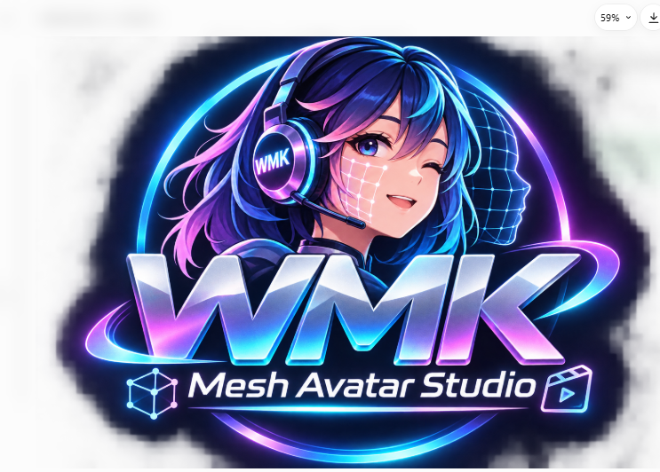

#  WMK Mesh Avatar Studio

**Walney Moreira Klein — walneyk@hotmail.com**

[English](README.en.md) · [日本語](README.ja.md) · [简体中文](README.zh.md)

## O que é?

O WMK Mesh Avatar Studio é um editor de avatares animados em 2D. A partir de uma ilustração PNG, um agente de programação prepara camadas e um arquivo de configuração (rig). No editor, você ajusta olhos, boca, cabeça, cabelo, corpo e pré-visualiza os movimentos. O modo Live permite controlar o avatar com webcam e microfone; a visualização pode ser capturada no OBS.

> **Importante:** o programa não converte automaticamente qualquer foto em avatar pronto apenas com um clique. A preparação das camadas e do rig exige um fluxo de criação, normalmente assistido por agente de programação.

## Requisitos

- Windows 10/11, macOS ou Linux.
- Node.js 22.17 ou superior, npm e Git.
- Python e uv para reconstruir camadas e fluxos de criação.
- Chromium do Playwright para revisões de movimento e alguns testes visuais.
- Webcam e microfone opcionais para o modo Live.

## Instalação no Windows

Abra PowerShell ou Prompt de Comando:

```bat
cd /d C:erramentas
git clone https://github.com/WalneyNF/mesh-avatar-studio.git
cd mesh-avatar-studio
npm install
npm run doctor
npm run dev
```

Se você já instalou o projeto, **não clone novamente**. Basta entrar na pasta existente e executar `npm run doctor` e `npm run dev`.

Abra o endereço mostrado pelo Vite, geralmente `http://127.0.0.1:5173/`. Se a porta estiver ocupada, use o endereço informado pelo terminal. Escolha **PT-BR** no seletor de idiomas.

### Dependência opcional para criação e testes

```bat
npx playwright install chromium
```

Esse download pode consumir espaço em disco. O editor e a página Live podem funcionar sem ele, mas algumas rotinas de criação e testes exigem o navegador.

## Primeiro contato: passo a passo

1. Inicie o editor com `npm run dev`.
2. Abra o projeto de exemplo Miko para explorar a interface. O exemplo original é somente leitura.
3. Escolha uma parte na lista à esquerda: olhos, boca, cabeça, cabelo ou corpo.
4. Arraste os pontos sobre a imagem e acompanhe a pré-visualização.
5. Para editar o exemplo, use a opção de **copiar e continuar editando**.
6. Salve as alterações do rig. Se mudar contornos que afetam as camadas, reconstrua as camadas antes de exportar.

## Criar um avatar próprio

Use preferencialmente uma ilustração frontal em PNG com fundo transparente. Um agente de programação pode seguir [o guia técnico](docs/agent-guide.md) para gerar a pasta em `projects/NOME/`, incluindo `source.png`, `rig.json`, `layers.json` e os recursos em `built/`.

Você também pode estudar o fluxo com:

```bat
npm run create -- --help
```

Algumas opções de geração podem enviar imagens a serviços externos de IA, mediante consentimento. Consulte as opções de privacidade e `--no-variants` antes de usar.

## Importação e exportação

No editor, use **Exportar .mavatar** para compartilhar o avatar, com rig, camadas e metadados. Inclua a imagem original se desejar permitir edições posteriores. A importação cria um projeto local. Arquivos sem imagem original podem ser reproduzidos, mas não totalmente reeditados.

## Webcam, microfone e OBS

1. Abra um projeto no editor e entre em **Live**.
2. Autorize a webcam e, opcionalmente, o microfone no navegador.
3. Posicione o rosto de frente e execute a calibração.
4. Ajuste sensibilidade, suavização, espelhamento e expressões.
5. Copie a URL de transmissão para uma **Fonte de navegador** no OBS.
6. Mantenha a página Live aberta enquanto transmitir.

O rastreamento facial usa MediaPipe. A transmissão local encaminha valores numéricos de movimento; consulte a documentação de privacidade e transmissão antes de expor o serviço em uma rede.

## Comandos para desenvolvedores

```bat
npm run dev
npm run build
npm test
npm run lint
npm run doctor
npm run e2e
```

**Estrutura principal:** `src/editor` (interface e rig), `src/live` (webcam e transmissão), `src/lighting` (iluminação), `src/server` (API local), `packages/runtime` (motor), `packages/element` e `packages/react` (integrações).

A tradução PT-BR está em desenvolvimento; alguns módulos ainda apresentam termos em inglês. A identidade WMK utiliza a paleta azul-noturno, ciano, violeta e magenta.

## Personalização visual

A logo oficial deve ficar em `logo.png`. Os estilos estão em `src/editor/style.css` e `src/live/live.css`. Veja também o [raio X técnico](RAIO-X-WMK-PTBR.html).

## Solução de problemas

- **Porta ocupada:** use a URL informada pelo Vite.
- **Dependências ausentes:** execute `npm install` e depois `npm run doctor`.
- **Sem acesso à webcam:** confira permissões do navegador e se outra aplicação está usando a câmera.
- **Projeto não abre:** confira `rig.json`, `layers.json`, imagens e permissões da pasta.
- **Falha EPERM em testes de links simbólicos:** no Windows, alguns testes exigem permissão para criar symlinks; não altere a segurança do sistema sem avaliar a necessidade.

## Licenças e créditos

Este fork preserva os direitos e licenças dos autores e componentes originais. O código original é MIT, mas **o personagem de exemplo Miko não é coberto pela licença MIT**; consulte [os termos do personagem](samples/miko-qipao/MIKO_ASSET_TERMS.md). MediaPipe e modelos relacionados têm licenças próprias em `vendor/mediapipe/`.

**Personalização WMK:** Walney Moreira Klein — walneyk@hotmail.com.
